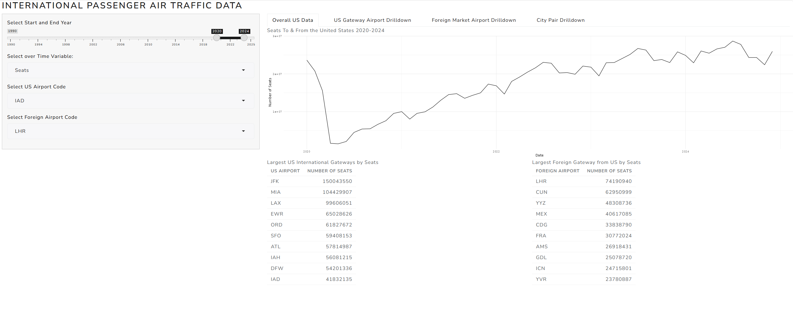
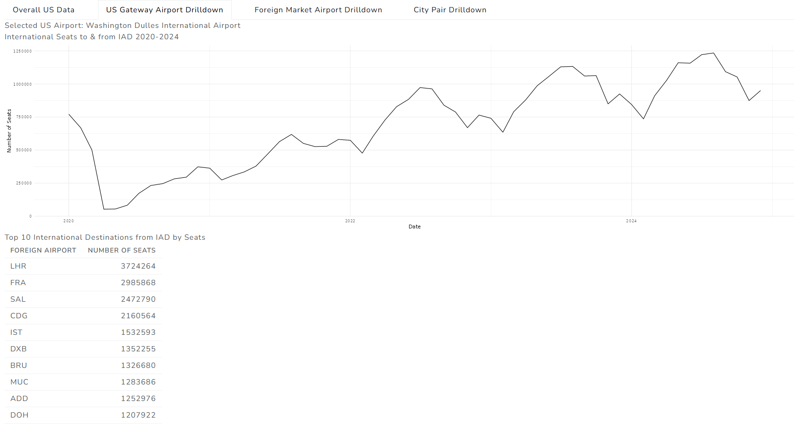
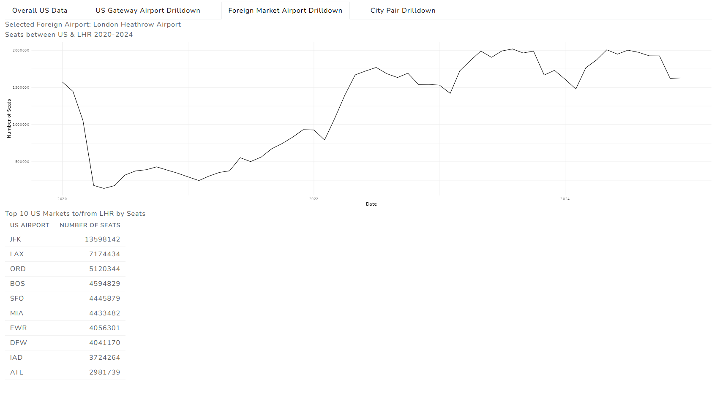
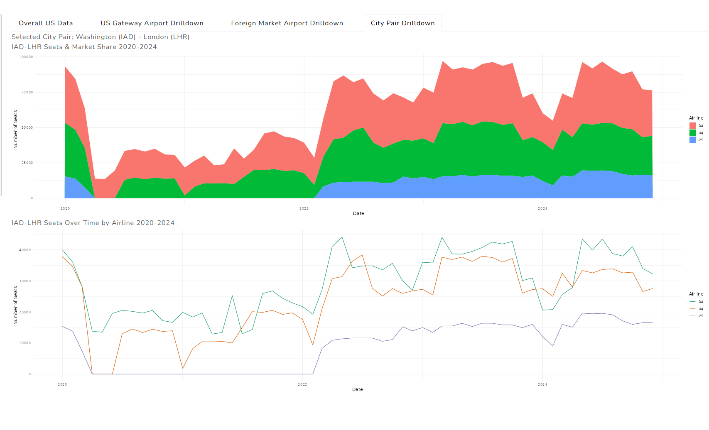

# International Passenger Traffic to/from the US

[Launch App](https://01a117cf-4f0c-7f31-f24d-ef28fc2d12bf.share.connect.posit.cloud/)

This app explores international passenger traffic to & from the United States
based on the United States' Department of Transportation's International Air Passenger
freight statistics. Users can explore routes to/from the United States, specific
airports, and or drill down to a specific city for traffic going back to 1990. 

## Highlights

- Explore how international travel between the US and United States have changed over time
- Explore airline competition over a given route over time

## Overview

### Data Filtering

The sidebar controls all four tabs. Users can select a year range,
US Airport, and Foreign Airport, and metric to explore. 

### Metrics

**Departures** - count of departures over the selected time period.

**Seats** - count of available seats over the selected time period

**Passengers** - count of passengers carried over the selected time period

_Numbers are round-trip for a given route (For example, including both Washington-London and London-Washington segments)_

### Tabs

**Overall US Data** - showcases a time trend and top 10 US gateway
and foreign destination markets by the chosen metric cumulatively over the 
time period. 

 

**US Gateway Airport Drilldown** - showcases a time trend and top 10
foreign airports by the chosen metric over the time period. 

 

**Foreign Airport Drilldown** - showcases a time trend and top 10 US origin markets
by the chosen metric over the time period. 

 

**City Pair Drilldown** - showcases a time trend of the metric between the selected 
US and Foreign Airports over the time period in two visualizations:

- An area plot showing total numbers for the metric as well as airline market share
- A line plot to visualize capacity trends for the chosen metric broken down by individual airline over time

 

### Data Source

Data are from the United States Department of Transportation's [International Air Passenger
and Freight statistics](https://data.transportation.gov/Aviation/International_Report_Seats/bpdu-tujd/about_data). The metrics are derived from segment reports that airlines submit to the Bureau of 
Transportation Statistics' Office of Airline Information as part of its T-100 program. 

Segment reports are reported by airlines "as flown", not "as scheduled". In practice, the implication
of this is that a flight, for example, from London to New York that is diverted to 
Bangor, Maine on a one-off basis due to weather or an onboard emergency, would be reported
as a London-Bangor flight even though it was scheduled as a London-New York flight. As the
purpose of this application is to capture trends in the US International Aviation market
as opposed to operational occurrences, city pairs with fewer than 4 departures per month
have been excluded. It is not practical to exclude all one-off diversions, however, without
also excluding regularly scheduled flights that operate rarely or with smaller aircraft
types, so some less-frequent city pairs may reflect several one-off diversions within a single
month (for example, if a month of bad weather caused the same  flight to have to 
divert to the same airport multiple times) rather than a regularly scheduled flight. 

